# Laporan UTS Deep Learning

**Klasifikasi Multimodal, Regresi Remaining Useful Life, dan Clustering Multimodal**

| Nama | NIM | Bagian |
|---|---|---|
| Muhammad Alief Reefandi | 101032330132 | Task 1 |
| Rofly Hi M Naser | 101032300085 | Task 2, Task 3 |

Repositori: `github.com/AliefReefandi/UTS-Deep-Learning`. Semua angka di laporan ini dibaca dari
berkas hasil di `results/`. Reproduksi: `python run_all.py` (seed 42; versi library dicatat di
`env_info.json`). Hanya data yang diberikan yang dipakai; tidak ada data eksternal atau bobot pretrained.

## Ringkasan

| Task | Model utama (deep learning) | Pembanding | Hasil validasi | Berkas prediksi |
|---|---|---|---|---|
| 1. Klasifikasi cacat produk | Feature Fusion (CNN 2D + CNN 1D) | Decision Fusion, image-only, sensor-only | Macro-F1 0,659 ± 0,013 (3 seed) | `prediksi_klasifikasi.csv` |
| 2. Prediksi RUL | LSTM, ensemble 5 fold | Gradient boosting (non-DL), TCN, Transformer | RMSE 19,14; skor 4.673 / 300 mesin | `prediksi_rul.csv` |
| 3. Clustering material | SimCLR + FusionAE + IDEC | KMeans, GMM | k = 6; stabilitas 0,96 | `cluster.csv` |

<!-- ALIEF: cek pemetaan subbab 1.1–1.7 ke poin a–g soal Task 1 dan sesuaikan judulnya. -->

# Task 1 – Klasifikasi Multimodal Cacat Produk

Tujuan: mengklasifikasikan unit produk ke 7 kelas (normal, gores, noda, retak, gelembung, las_dingin,
kontaminasi) dari foto permukaan 64×64 dan sinyal sensor 3 kanal × 128 titik (suhu, getaran, arus).
Data latih 48.000 unit, data uji 16.000 unit. Notebook: `kode/01_Task1_Classification.ipynb`.

## 1.1 Eksplorasi data

- **Kelas tidak seimbang:** normal 23.888 (49,8%), kontaminasi hanya 2.357 (4,9%). Karena itu metrik
  utama adalah **Macro-F1**, yang memberi bobot sama untuk tiap kelas.
- **Domain shift antar-lini:** data latih didominasi lini A (74,9%), sedangkan data uji didominasi
  lini B (60,0%). Ini diuji khusus di bagian 1.5.
- **Missing value sensor** sekitar 5,9% per kanal, tersebar merata di ketiga kanal.
- **Sensor:** suhu terkonsentrasi di 181–182 °C, getaran bimodal di sekitar nol, arus 9–10 A dengan ekor ke bawah.
- **Citra:** tekstur granular/bintik dan garis memanjang/diagonal, dengan perbedaan antar-kelas yang halus.

## 1.2 Preprocessing

- Label di-encode ke 0–6. Citra dibagi 255.
- Split **stratified 80/20** (seed 42): 38.400 latih / 9.600 validasi, proporsi kelas terjaga.
- **Imputasi sensor:** rata-rata per titik waktu dari data latih saja. Setelah itu z-score per kanal
  dengan statistik data latih, dipakai juga untuk validasi dan uji, sehingga tidak ada kebocoran.

## 1.3 Arsitektur

- **Encoder citra:** CNN 3 blok (Conv–BN–ReLU–Pool; 32/64/128 filter) dengan global average pooling → 128 dimensi.
- **Encoder sensor:** CNN 1D 3 blok (kernel 5/5/3) dengan global average pooling → 128 dimensi.
- **Image-only / sensor-only:** encoder + dropout 0,3 + linear.
- **Feature Fusion:** konkatenasi dua fitur (256) → MLP 128 → 7 kelas.
- **Decision Fusion:** dua kepala klasifikasi terpisah; logit dirata-rata.
- **Training:** Adam (lr 3·10⁻⁴), cross-entropy berbobot kelas (*balanced*), batch 64, maks. 30 epoch,
  early stopping (patience 8) pada Macro-F1 validasi.

## 1.4 Perbandingan model (3 seed: 42, 123, 2026)

| Model | Mean Macro-F1 | Std |
|---|---:|---:|
| **Feature Fusion** | **0,6591** | 0,0126 |
| Decision Fusion | 0,6409 | 0,0242 |
| Sensor-only | 0,4339 | 0,0058 |
| Image-only | 0,3123 | 0,0170 |

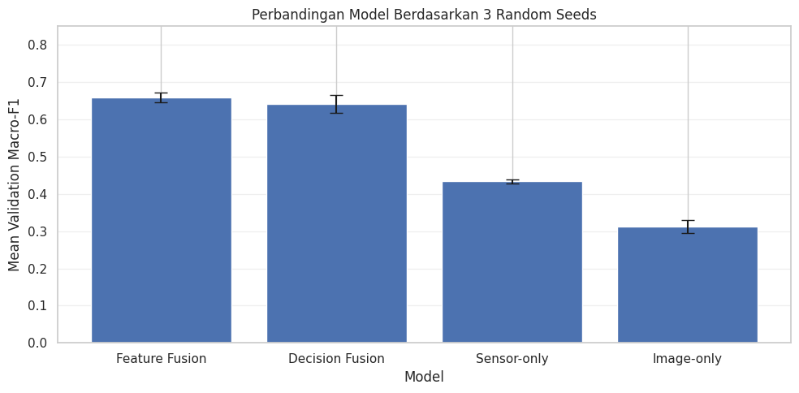{width=62%}

- Fusion jauh lebih baik dari satu modalitas (+0,23 dari sensor-only): citra dan sensor membawa
  informasi yang saling melengkapi.
- Feature Fusion sedikit lebih baik dan lebih stabil daripada Decision Fusion. Penggabungan di tingkat
  fitur memungkinkan interaksi antar-modalitas, sedangkan rata-rata logit menggabungkan dua keputusan
  yang dibuat terpisah. Model final: Feature Fusion (`models/feature_fusion_final.pth`).

<!-- ALIEF: confusion matrix dan learning curve yang tersimpan adalah Decision Fusion (seed 42), bukan model final Feature Fusion. Pertimbangkan menyimpan versi Feature Fusion. -->

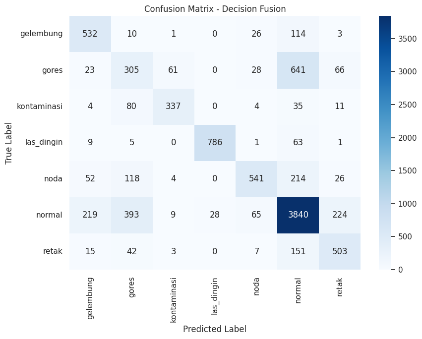{width=55%}

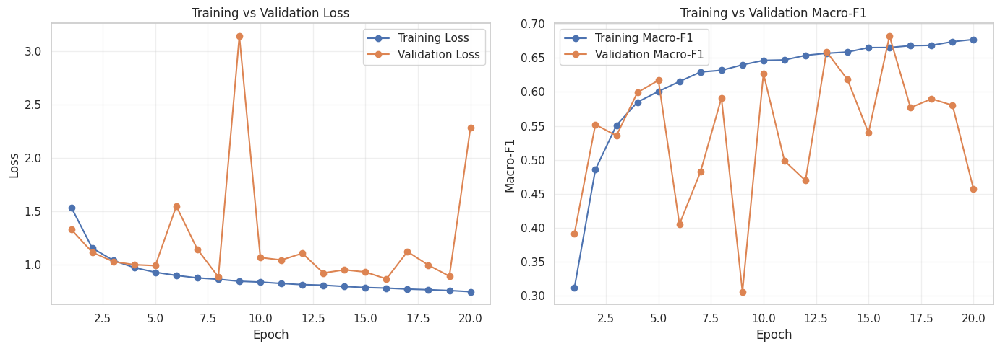{width=85%}

**Per kelas** (Decision Fusion, seed 42; Macro-F1 0,682, akurasi 71,3%):
- *las_dingin* paling mudah (F1 0,94).
- *gores* paling sulit (F1 0,29): 641 dari 1.124 sampel gores diprediksi *normal*. Goresan tipis sulit
  terlihat pada citra 64×64, dan pola sensornya mirip normal.
- **Kurva training:** val loss berfluktuasi tajam (puncak epoch 9 dan 20) sementara train loss terus
  turun. Pemilihan epoch terbaik pada set validasi yang sama dengan pelaporan membuat angka sedikit optimistis.

## 1.5 Robustness

| Eksperimen | Kondisi | Macro-F1 validasi |
|---|---|---:|
| Label noise (label latih diacak sebagian) | 0% / 10% / 20% | 0,682 / 0,609 / 0,548 |
| Domain shift (evaluasi pada lini B) | latih A+B / latih A saja | 0,587 / **0,197** |
| Missing modality (saat inferensi) | lengkap / tanpa citra / tanpa sensor | 0,682 / 0,351 / 0,301 |

- **Label noise:** penurunan bertahap, tidak runtuh. Model masih > 0,54 pada noise 20%. Ini relevan
  karena label inspektur tidak dijamin benar.
- **Domain shift** adalah risiko terbesar: tanpa data lini B, Macro-F1 di lini B turun ke 0,197. Karena
  data uji 60% lini B, kedua lini wajib ada di data latih.
- **Missing modality:** model belum dilatih untuk kehilangan modalitas (mis. dengan modality dropout),
  sehingga performanya turun ke tingkat satu modalitas.

<!-- ALIEF: eksperimen 1.5 dan 1.6 memakai Decision Fusion, sedangkan model final Feature Fusion. Jelaskan alasannya atau ulangi untuk Feature Fusion. -->

## 1.6 Sanity check

Melatih dengan label latih yang diacak total menurunkan Macro-F1 validasi dari 0,682 ke **0,137**,
mendekati tingkat tebakan acak untuk 7 kelas. Jadi model memang mempelajari hubungan input–label,
bukan artefak pipeline.

## 1.7 Prediksi data uji

Model final Feature Fusion memprediksi 16.000 unit uji ke `prediksi_klasifikasi.csv` (`id_unit,kelas`).
Format lolos `python -m kode.validasi_csv`.

<!-- ALIEF: tambahkan baseline non-DL bila diminta soal, dan catat distribusi kelas prediksi test (cek pengaruh domain shift lini B). -->

# Task 2 – Prediksi Remaining Useful Life (RUL)

Data: 900 mesin latih (run-to-failure, 254.174 siklus) dan 300 mesin uji (berhenti acak; histori
50–455 siklus). Prediksi RUL di siklus terakhir tiap mesin uji, dengan cap 150. Kode: `kode/task2/`;
hasil: `results/task2/`.

## 2a. EDA dan preprocessing

| Temuan | Keputusan |
|---|---|
| 6 rezim operasi diskret dari `setel_1`. Rezim menjelaskan 37–100% varians sensor (η²); loncatan antar-rezim jauh lebih besar daripada tren degradasi | **z-score per rezim**, statistik hanya dari mesin latih tiap fold |
| 7 sensor (s01, s05, s06, s10, s16, s18, s19) murni white noise: std(Δz)/std(z) ≈ √2 | Dibuang (ambang 1,2; tanpa label → tidak bocor). Sisa 14 sensor |
| Dua mode kerusakan (A 558 mesin, B 342) dengan arah degradasi berlawanan (mis. s11). Korelasi global s11–RUL hanya 0,16, padahal per mesin 0,75 | Seleksi sensor **tidak** memakai korelasi dengan RUL. Mode tidak dijadikan fitur, hanya dipakai untuk analisis galat |
| Missing ~2% per sensor, acak; ada juga di baris terakhir data uji | **Forward-fill** per mesin (kausal, tanpa interpolasi) |
| Spike 0,2% titik, \|z\| sampai 10 | Median **10 siklus sebelumnya**; ganti jika > 5σ robust. Lalu clip ±5 |

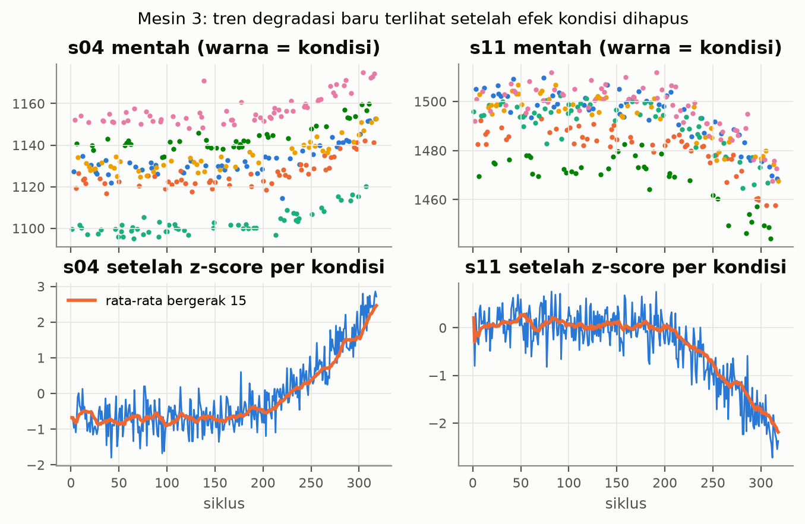{width=88%}

## 2b–c. Label RUL dan sliding window tanpa kebocoran

- **Label:** RUL = siklus_maks − siklus, dipotong pada 150. EDA menunjukkan sensor datar selama RUL >
  ~150, sehingga umur sisa 300 dan 200 memang tidak dapat dibedakan.
- **Window:** satu sampel per (mesin, siklus t) dengan input baris t−49..t mesin itu saja. W = 50 =
  histori uji terpendek. Histori < 50 di-pad kiri dengan 0 plus kanal **mask**. Fitur per langkah:
  14 sensor + umur + mask = 16.
- **Split per mesin (5-fold).** Validasi **meniru data uji**: histori tiap mesin validasi dipotong di
  5 titik acak, dan hanya siklus terakhir yang dinilai (4.500 sampel validasi).
- **Bukti tidak bocor:** 6 uji otomatis (`test_leakage`).
  - Uji utama: mengacak semua data sesudah t tidak mengubah window di t setelah preprocessing.
  - Uji lain: isolasi antar-mesin, preprocessor hanya di-fit di data latih, dan tidak ada mesin di dua sisi split.
  - **Uji mutasi:** interpolasi/bfill dan median berpusat sengaja disuntikkan, dan tes berhasil menangkapnya.

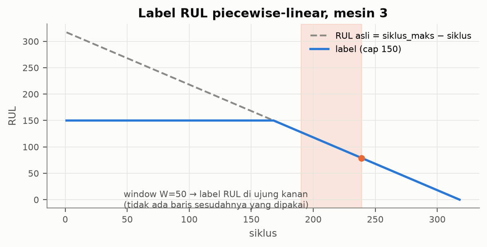{width=80%}

## 2d. Model: baseline vs tiga arsitektur sequence

- **Baseline non-DL:** HistGradientBoosting pada 58 fitur manual: per sensor level 5 siklus terakhir, rata-rata, kemiringan, dan std window, ditambah umur dan panjang histori.
- **LSTM:** 2 lapis, 64 unit, kepala MLP. **TCN:** 4 blok konvolusi kausal (48 kanal, dilasi 1/2/4/8).
  **Transformer:** 2 blok self-attention (d = 64, 4 head).
- **Training:** MSE pada RUL/150, AdamW + OneCycle, AMP, early stopping (patience 8) pada RMSE validasi,
  checkpoint per epoch (bisa resume di Colab).

| Model | Parameter | RMSE (mean ± std fold) | MAE | Bias | Skor / 300 |
|---|---:|---:|---:|---:|---:|
| **LSTM** | 69.761 | **19,13 ± 0,58** | 14,52 | **+0,51** | **4.673** |
| TCN | 58.097 | 19,51 ± 0,52 | 14,97 | +2,46 | 5.226 |
| Transformer | 103.041 | 19,75 ± 0,51 | 14,45 | +1,55 | 6.170 |
| Baseline (GBM) | – | 19,82 ± 0,80 | 14,44 | +2,24 | 6.654 |

**Pilihan: LSTM** (hanya model DL yang dipertimbangkan).
- RMSE dan skor asimetris terbaik. Skornya 30% lebih rendah dari baseline, karena biasnya paling kecil:
  prediksi terlambat (d > 0) dihukum eksponensial lebih berat.
- Perbandingannya berpasangan: LSTM mengalahkan baseline di **kelima** fold.
- Transformer paling cepat overfit (val naik setelah ~epoch 7). Dengan hanya 900 mesin, kapasitas tambahan tidak membantu.

## 2e. Evaluasi per rentang RUL

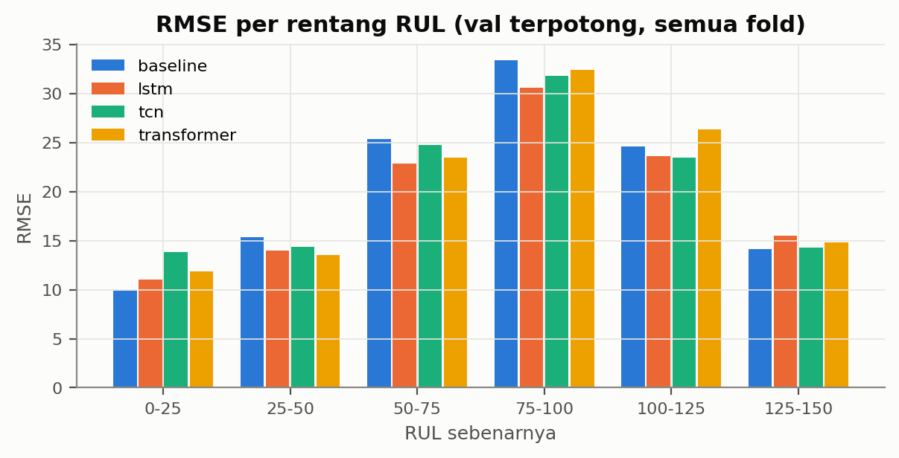{width=49%} 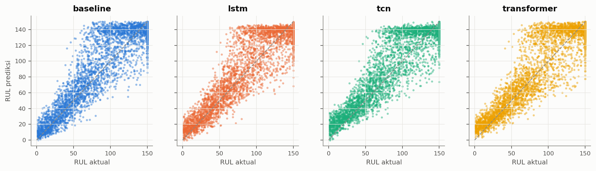{width=49%}

| RUL aktual | n | Baseline | LSTM | TCN | Transformer | Bias LSTM |
|---|---:|---:|---:|---:|---:|---:|
| 0–25 | 521 | **9,9** | 11,1 | 13,8 | 11,8 | +7,1 |
| 25–50 | 570 | 15,4 | 14,0 | 14,3 | **13,6** | +3,9 |
| 50–75 | 567 | 25,4 | **22,8** | 24,7 | 23,5 | +8,4 |
| 75–100 | 501 | 33,4 | **30,6** | 31,8 | 32,4 | +14,5 |
| 100–125 | 474 | 24,6 | 23,6 | **23,5** | 26,4 | +9,4 |
| 125–150 | 1.867 | **14,2** | 15,5 | 14,3 | 14,8 | −10,7 |

- **Galat terbesar di RUL 50–100**, dan biasnya positif (terlambat). Di fase ini degradasi baru mulai
  dan sinyal sensor masih lemah. Ketiga arsitektur DL mentok di angka yang mirip, jadi batas ini datang
  dari informasi di data.
- **RUL > 125:** bias negatif, efek cap. Kesalahannya ke arah aman (servis sedikit lebih awal).
- **Per mode kerusakan:** galat hampir sama (A 18,99; B 19,39), jadi model tidak hanya bekerja untuk mode mayoritas.

## 2f. Prediction interval dan kebijakan servis

- **Interval:** MC dropout (50 pass) × 5 model fold. Interval mentah hanya mencakup **54%** pada target
  90%, karena MC dropout hanya mengukur ketidakpastian model, bukan noise data dan variasi antar-mesin.
- **Kalibrasi:** split conformal ternormalisasi, interval = pred + q·std, dengan q dari kuantil residual
  validasi. Cakupan dihitung cross-fit (q tiap fold diestimasi dari 4 fold lain), sehingga jujur.
- **Cakupan terkalibrasi:** 0,499 / 0,797 / **0,899** / 0,948 untuk target 50 / 80 / 90 / 95%.
- **Keterbatasan:** kalibrasinya global, sehingga cakupan 90% kurang di RUL 25–100 (0,81–0,84) dan lebih di RUL > 100.

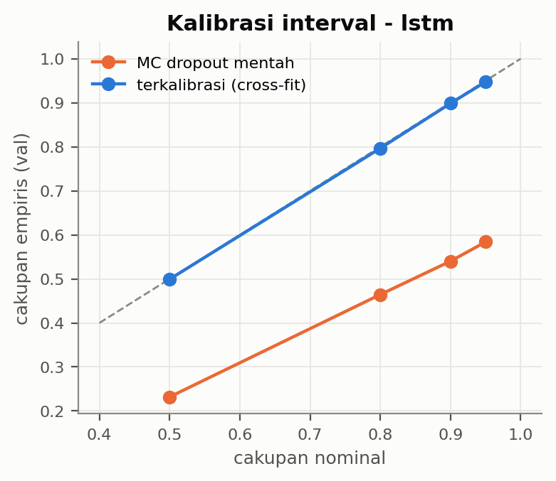{width=45%} 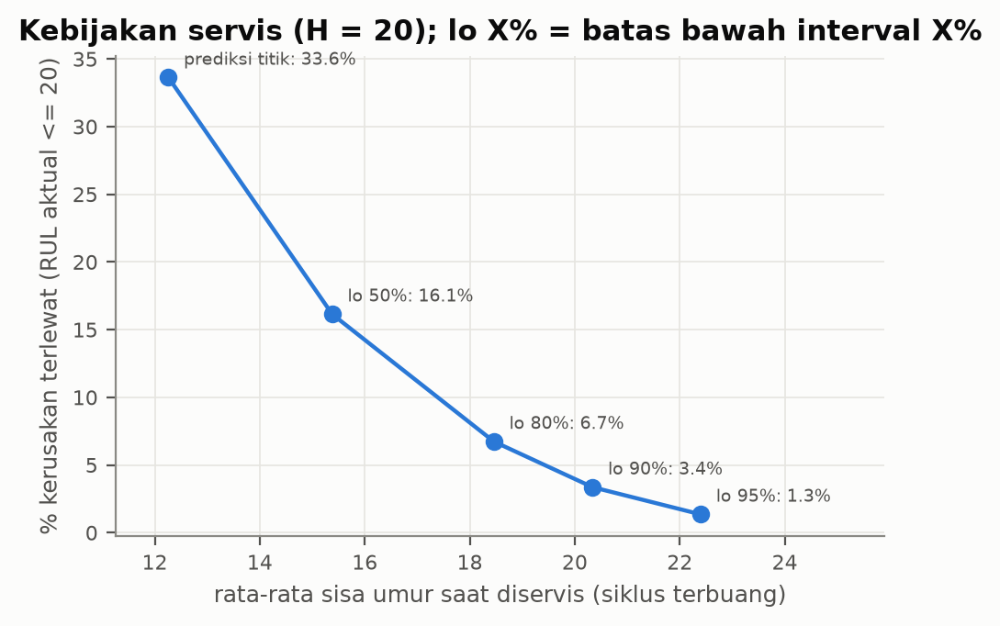{width=53%}

**Kapan mesin perlu diservis.** Asumsinya servis harus disiapkan H = 20 siklus sebelum rusak.

| Aturan "servis jika X ≤ 20" | Kerusakan tertangkap | Terlewat | Servis terlalu dini |
|---|---:|---:|---:|
| X = prediksi titik | 66,4% | 150 | 51 |
| X = batas bawah 80% | 93,3% | 30 | 260 |
| **X = batas bawah 90%** | **96,6%** | **15** | 331 |
| X = batas bawah 95% | 98,7% | 6 | 410 |

- **Rekomendasi: servis jika batas bawah interval 90% ≤ 20 siklus.** Kerusakan terlewat turun 90%
  dibanding prediksi titik. Biayanya lebih banyak servis dini, tetapi rata-rata mesin yang diservis
  masih punya ~20 siklus.
- **Pilihan level mengikuti biaya:** 95% jika kerusakan jauh lebih mahal daripada servis, 80% jika servis mahal.
- **Hasil pada 300 mesin uji:** **64 servis segera**, 75 dijadwalkan (batas bawah 20–50), 161 aman.
  Tanpa interval hanya 20 mesin yang akan ditandai.

# Task 3 – Clustering Multimodal Jenis Material

36.000 sampel tanpa label: citra mikrostruktur 64×64 dan spektrum komposisi 128 kanal, dari dua
mikroskop (M1 21.636, M2 14.364). Jumlah jenis material tidak diketahui. Kode: `kode/task3/`; hasil:
`results/task3/`.

## 3a. EDA distorsi

| Distorsi | Bukti | Keputusan |
|---|---|---|
| **Rotasi acak** | Orientasi dominan (structure tensor) menyebar di 0–180°. Ketidakrataan kecil juga muncul pada garis sintetis bersudut seragam, jadi itu bias estimator | Augmentasi rotasi bebas + flip |
| **Skala** | Tekstur garis membentuk 2 kelompok skala terpisah (λ ≈ 5 dan 11–12 px) | Augmentasi skala **ringan** (±15%) agar garis halus dan kasar tidak disamakan |
| **Brightness / mikroskop** | M2 lebih terang (146 vs 128). Setelah standardisasi, mikroskop **masih** tertebak dari PSD (AUC 0,88): M2 lebih berderau | Standardisasi per gambar + augmentasi noise/blur |
| **Spike spektrum** | 0,2% titik, selalu positif, 1 kanal. Residual bimodal (≤ 0,37 vs ≥ 0,80) | Despike dengan ambang 0,5 terhadap median 5 kanal |
| **Baseline** | Offset/kemiringan/lengkung lambat per spektrum | Kurangi baseline polinom-2 (modpoly), lalu normalisasi L2 |
| **Shift** | Ketiga puncak bergeser bersama (r = 0,90); 95% shift dalam ±7 kanal | Augmentasi shift ±7 dan stretch ±3%; CNN 1D dengan pooling |
| **Mikroskop pada spektrum** | AUC menebak mikroskop dari spektrum = 0,50 | Spektrum bebas efek alat, sehingga menjadi jangkar untuk menguji koreksi mikroskop (3c) |

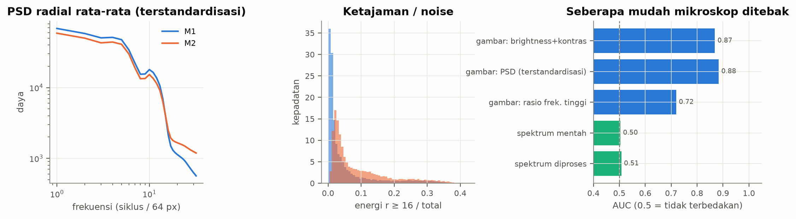{width=92%}

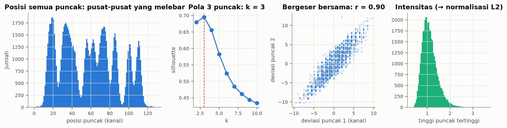{width=92%}

## 3b. Representation learning tanpa label: SimCLR

- **Metode:** SimCLR per modalitas dengan loss NT-Xent (τ = 0,2). Dua view augmentasi dari sampel yang
  sama ditarik mendekat; sampel lain dalam batch (512) didorong menjauh.
- **Alasan dipilih:** autoencoder piksel harus merekonstruksi semua detail, termasuk orientasi dan noise
  mikroskop. SimCLR diajari langsung untuk **mengabaikan** distorsi yang ditemukan di EDA.
- **Augmentasi gambar:** crop 36×36 yang dirotasi bebas dan selalu berada di dalam gambar, flip, skala
  ±15%, gamma, blur, noise, standardisasi.
  - Versi awal memakai padding refleksi. Padding itu ternyata menciptakan tekstur "chevron" palsu, jadi diganti crop di dalam gambar.
- **Augmentasi spektrum:** shift ±7, stretch ±3%, sisa baseline, noise, spike sintetis.
- **Encoder:** ResNet kecil untuk gambar (1,23 jt parameter, embedding 256, TTA 8 orientasi saat
  inferensi) dan CNN 1D untuk spektrum (0,24 jt, embedding 128).
- **Training:** 150/100 epoch di Kaggle GPU (14,2 + 1,7 menit), AMP, checkpoint dan resume.

| Diagnostik (tanpa label) | Gambar: PSD radial | Gambar: SimCLR | Spektrum: PCA | Spektrum: SimCLR |
|---|---:|---:|---:|---:|
| Retrieval view-ke-view top-1 (↑) | 0,016 | **0,367** | 0,018 | **0,796** |
| Rank efektif | 14,4 | 70,3 | 17,6 | 37,6 |
| AUC tebak mikroskop (ideal 0,5) | 0,88 | 0,99 | 0,50 | 0,50 |

- SimCLR jauh lebih tahan distorsi daripada fitur klasik: retrieval 20–40× lebih tinggi.
- Kesepakatan cluster gambar vs spektrum (AMI) tertinggi di k = 6 (0,80 vs 0,53 untuk fitur klasik).
- **Masalah yang tersisa:** embedding gambar tetap membawa jejak mikroskop (AUC 0,99), dan ini ditangani di 3c.

## 3c. Fusion dan apa yang hilang dengan satu modalitas

1. **Blok per modalitas:** L2 → PCA 95% varians → total varians 1 (gambar 16 dimensi, spektrum 14),
   sehingga kedua modalitas berbobot sama.
2. **Koreksi mikroskop bersyarat:** blok gambar dikurangi rata-ratanya per mikroskop. Ini hanya sah jika
   komposisi material tidak bergantung pada alat, dan syarat itu diuji pada spektrum yang bebas alat:
   Cramér's V (cluster spektrum, mikroskop) maks. **0,001** < 0,10. Hasilnya, semua cluster akhir punya
   V terhadap mikroskop 0,00 dan proporsi M2 39–41% di setiap cluster.
3. **FusionAE (deep fusion):** autoencoder MLP 30 → 256 → 128 → **16** dengan **modality dropout**
   (satu blok dinolkan dengan p = 0,25 dan harus direkonstruksi dari modalitas lain).
   - Latent dipaksa memuat informasi bersama **dan** unik per modalitas.
   - Fusion kontrastif ala CLIP tidak dipakai, karena hanya mempertahankan informasi bersama.
   - R² rekonstruksi silang: 0,61 (gambar dari spektrum) dan 0,67 (spektrum dari gambar).

**Ablasi:** KMeans (k = 6) pada tiap representasi.

| Representasi | ARI vs final | Akurasi kNN label final | Pasangan cluster tak terpisah (akurasi a-vs-b < 0,75) |
|---|---:|---:|---|
| Gambar saja | 0,999 | 1,000 | – |
| **Spektrum saja** | **0,687** | 0,772 | **c2–c5, c3–c4** (akurasi 0,48–0,52 = menebak) |
| Concat / FusionAE | 1,000 | 1,000 | – |

- **Yang hilang tanpa citra:** dua pasangan material dengan spektrum **identik** yang hanya berbeda
  tekstur (bintik terang vs pulau gelap; garis lurus vs garis bergelombang).
- **Peran spektrum:** pada k = 6 citra saja sudah cukup. Spektrum tetap berguna sebagai konfirmasi
  independen yang bebas efek mikroskop, dan sebagai satu-satunya sumber faktor jarak puncak di c0 (3f).

## 3d–e. Metode clustering dan jumlah cluster

**Pemilihan k (aturan ditetapkan sebelum melihat hasil):**
1. Hitung silhouette, Davies-Bouldin, Calinski-Harabasz, stabilitas bootstrap (ARI antar-subsampel 80%) dan BIC GMM untuk k = 2–15 pada latent FusionAE.
2. Kandidat = k dengan stabilitas ≥ 0,80.
3. Pilih jumlah peringkat (silhouette + DB + CH) terkecil.

Ketiga kriteria internal sepakat di **k = 6** (silhouette 0,472, DB 0,871, CH 20.859, stabilitas 0,963).
BIC terus turun tanpa siku, jadi hanya dipakai sebagai informasi. KMeans pada citra saja juga memilih k = 6.

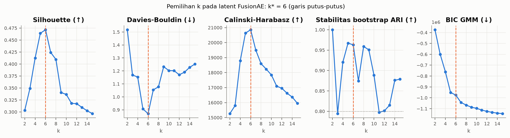{width=100%}

| Metode (k = 6, 3 seed) | Jenis | Silhouette (ruang sendiri) | Stabilitas antar-seed | Cluster terkecil |
|---|---|---:|---:|---:|
| KMeans (concat) | klasik | 0,511 | 1,000 | 10,2% |
| KMeans (FusionAE) | klasik | 0,472 | 1,000 | 10,2% |
| GMM kovarians penuh (FusionAE) | klasik | 0,378 | 0,838 | 10,2% |
| **IDEC (FusionAE)** | **deep** | **0,702** | 1,000 | 10,2% |

- **IDEC** (DEC + rekonstruksi): encoder FusionAE dan pusat cluster dilatih bersama dengan loss
  KL(P‖Q) + 0,1·rekonstruksi, dengan soft assignment Student-t. Rekonstruksi menjaga latent agar tidak collapse.
- **Hasil apa adanya:** IDEC konvergen setelah 1 epoch tanpa label yang berubah, dan partisinya
  **identik** dengan KMeans (ARI 1,00). Keenam cluster sudah terpisah jelas di latent FusionAE. IDEC
  hanya merapatkannya (silhouette 0,47 → 0,70).
- **GMM** paling tidak stabil (ARI 0,78 terhadap metode lain), karena kovarians penuh membuatnya lebih bergantung pada inisialisasi.
- **Model final:** IDEC (aturan "model utama deep learning"). Pengaman collapse terpenuhi (cluster terkecil 10,2% ≥ 0,5%).

## 3f. Visualisasi dan cluster yang sulit dipisahkan

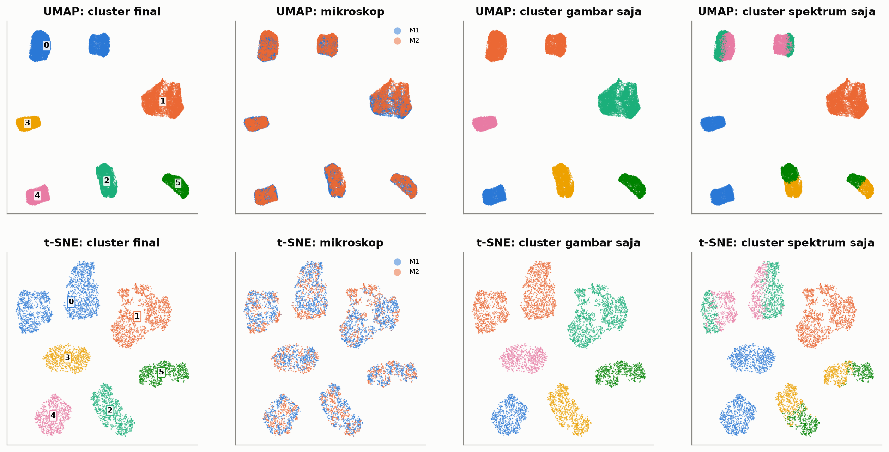{width=100%}

UMAP dan t-SNE hanya dipakai untuk visualisasi; clustering dilakukan di latent 16 dimensi. Warna
mikroskop tercampur di setiap cluster. Cluster "spektrum saja" memotong cluster final secara acak di
c2/c5 dan c3/c4.

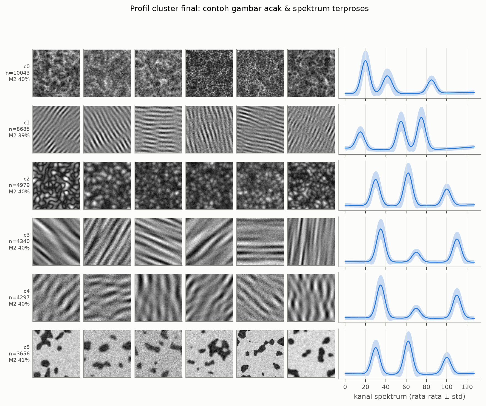{width=72%}

| Cluster | n | Tekstur | Puncak spektrum | Kelompok spektrum |
|---|---:|---|---|---|
| c0 | 10.043 | butiran poligonal + berawan | 20 / 40–44 / 85 | B |
| c1 | 8.685 | garis halus (λ ≈ 5 px) | 15 / 55 / 75 | A |
| c2 | 4.979 | bintik/sel terang | 30 / 62 / 100 | C |
| c3 | 4.340 | garis lurus kasar | 35 / 70 / 110 | D |
| c4 | 4.297 | garis kasar bergelombang | 35 / 70 / 110 | D |
| c5 | 3.656 | pulau gelap di latar terang | 30 / 62 / 100 | C |

**Pasangan sulit.**
- Di ruang gabungan, tumpang tindih kNN antar-cluster 0% untuk semua pasangan.
- Pasangan tersulit adalah yang **hanya dapat dipisahkan oleh satu modalitas**: **c3–c4** dan **c2–c5**.
  Spektrumnya identik (akurasi 0,48/0,52), dan hanya tekstur yang membedakannya (akurasi 1,00).
- Sistem dengan satu sensor spektrum akan menggabungkan keduanya.

**Cluster 0 heterogen.** Pemeriksaan di dalam cluster (`kode/task3/heterogen.py`) menemukan dua faktor
yang saling **independen** (Cramér's V antar-faktor 0,00):
1. **Tekstur:** butiran poligonal (5.203) vs berawan (4.840). Akurasi tebak dari blok gambar 0,998, dari spektrum 0,51.
2. **Jarak puncak 1–2:** 20 vs 24 kanal (puncak 2 di ~40 vs ~44). Akurasi tebak dari spektrum 0,98, dari gambar 0,59.
   - Distribusinya bimodal **hanya di c0**: ΔBIC 4.488, jarak antar-mode 4,3 std.
   - Lima cluster lain unimodal (ΔBIC < 0, jarak 1,1–1,5 std).

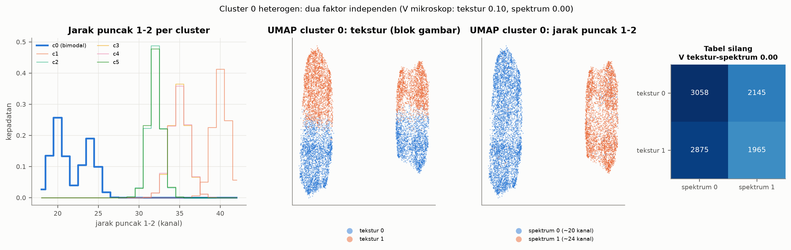{width=100%}

**Mengapa c0 tidak dipecah:**
- Pemecahan tekstur (k = 7) memenuhi aturan refinement kami: pemecahan murni, dengan V mikroskop 0,098 < 0,10.
- Tetapi itu bertentangan dengan aturan k yang ditetapkan sebelumnya, dan V-nya tepat di batas.
- Faktor spektrum yang independen juga membuka kemungkinan k = 9 (2 × 2).
- Tanpa label tidak dapat dipastikan mana yang menandai jenis material.

Kami melaporkan k = 6 dan menyimpan k = 7 sebagai pembanding (`results/task3/cluster_alternatif_k7.csv`).

**Koreksi interpretasi.** Dua "pulau" c0 di UMAP awalnya kami kira dua tekstur. Pemeriksaan per
modalitas menunjukkan pulau ditentukan oleh **jarak puncak spektrum** (akurasi tebak dari spektrum 1,00,
dari gambar 0,58). Struktur di proyeksi 2D perlu diverifikasi di ruang aslinya sebelum dijadikan bukti.

## 3g. Keterbatasan Task 3

- Jejak mikroskop dihapus di tahap fusion (centering), bukan di encoder. Encoder yang invarian alat
  (mis. adversarial) akan lebih bersih.
- Deep clustering tidak mengubah partisi KMeans pada data yang sudah terpisah jelas.
- Validasi tanpa label bergantung pada ukuran internal, konsistensi antar-modalitas, dan inspeksi visual.
  Jumlah material di c0 (1, 2, atau 4) tidak dapat dipastikan.

# Reproduksibilitas dan verifikasi

- `python run_all.py` menjalankan Task 1 (notebook via nbconvert), Task 2, dan Task 3, lalu memvalidasi ketiga CSV.
  - `--debug` menjalankan subset kecil di CPU.
  - Seed 42; versi library dicatat ke `env_info.json`.
  - Task 3c–f dapat dijalankan ulang di CPU dari bobot SimCLR di `models/` (~19 menit). Uji pada folder
    kosong menghasilkan `cluster.csv` yang identik dengan yang dikumpulkan (ARI 1,00).
- **Tes:** `kode/task2/test_leakage.py` (anti-kebocoran + uji mutasi), `test_models.py`,
  `kode/task3/test_ssl.py`, dan `test_cluster.py`. Tes Task 3 memakai data sintetis yang jawabannya diketahui.
- **Lingkungan:** Task 2 di Colab (Tesla T4; Python 3.13, torch 2.14), Task 3b di Kaggle GPU, Task 3c–f
  lokal (Python 3.14.7, torch 2.15 CPU, scikit-learn 1.9.1).
- **Penggunaan AI:** lihat `kontribusi.md`.
